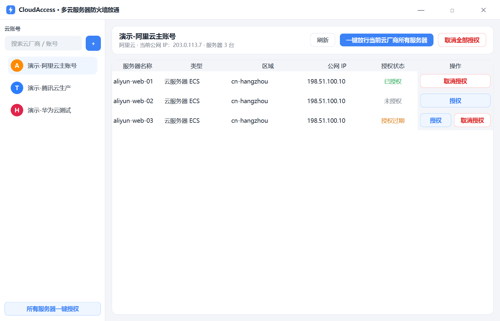
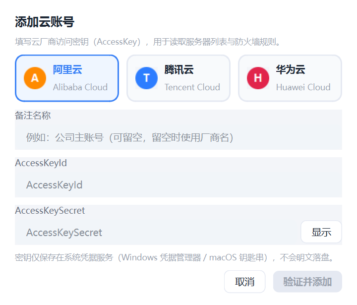

# ⚡ CloudAccess

[](https://github.com/drank5090/CloudAccess/releases)
[](https://github.com/drank5090/CloudAccess/actions)

[简体中文](README.md) | **English**

> One-click firewall access for multi-cloud servers: bind Alibaba Cloud / Tencent Cloud / Huawei Cloud accounts, list all your servers, and allow every port for your current IP with one click — revoke anytime.



## ✨ Features

- **Multi-cloud account binding** — Alibaba Cloud, Tencent Cloud and Huawei Cloud; multiple accounts per vendor are supported
- **Online validation** — AKSK credentials are verified live when adding an account
- **All-region discovery** — automatically finds servers in every region, covering cloud servers (ECS/CVM) and lightweight servers (SWAS / Lighthouse)
- **One-click authorize / revoke** — allow or remove all ports for your current public IP:
  - Per server: inline 「授权」authorize / 「取消授权」revoke buttons
  - Per vendor: 「一键放行当前云厂商所有服务器」button on the panel header
  - Cross account: 「所有服务器一键授权」button at the sidebar bottom
- **Authorization states** — Authorized / Unauthorized / Expired (a rule created by this app exists, but for a different IP)
- **Secure storage** — AK/SK are stored only in the OS credential service (Windows Credential Manager / macOS Keychain / Linux Secret Service), never in plaintext files
- **Frameless light theme** — a modern desktop experience built with PySide6

## 🖥 Screenshots

| Main window | Add account |
| --- | --- |
|  |  |

## 🧩 Supported services

| Vendor | Cloud servers | Lightweight servers | Firewall target |
| --- | --- | --- | --- |
| Alibaba Cloud | ECS | Simple Application Server (SWAS) | Security groups / SWAS firewall |
| Tencent Cloud | CVM | Lighthouse | Security groups / instance firewall |
| Huawei Cloud | ECS (incl. HECS/L) | — | Security groups |

## 🚀 Getting started

### Option 1: download a build (recommended)

Grab the archive for your platform from [Releases](https://github.com/drank5090/CloudAccess/releases),
extract it and run `cloudaccess` (Windows) or `./cloudaccess` (Linux).

### Option 2: run from source

Requires Python ≥3.11 and [uv](https://docs.astral.sh/uv/):

```bash
git clone https://github.com/drank5090/CloudAccess.git
cd CloudAccess
uv sync
uv run cloudaccess        # or: uv run python -m cloudaccess
```

### Add an account

1. Click the 「**+**」 button at the top of the sidebar
2. Pick a vendor → optional display name → paste AccessKeyId / AccessKeySecret
3. Click 「验证并添加」: the app validates the credentials online, then stores the secret in the OS credential service

> 💡 **Least privilege**: prefer a RAM sub-account with only server-read and security-group/firewall permissions:
> - Alibaba Cloud: `AliyunECSFullAccess` + `AliyunSWASFullAccess`
> - Tencent Cloud: `QcloudCVMReadOnlyAccess` + `QcloudVPCFullAccess` + `QcloudLighthouseFullAccess`
> - Huawei Cloud: `ECS FullAccess` + `VPC FullAccess`

## ⚙️ How it works

```mermaid
flowchart LR
    A[Bind account AKSK] --> B[Enumerate servers in all regions]
    B --> C[Read firewall rules]
    C --> D{Look for CA marker}
    D -- current IP hit --> E[Authorized]
    D -- no marker --> F[Unauthorized]
    D -- other IP hit --> G[Expired]
    E --> H[Inline revoke]
    F & G --> I["Authorize all ports (CA&#124;sid&#124;IP rule)"]
```



- **Rule markers**: every rule created by this app carries a `CA|<short-account-id>|<IP>`
  description marker, fully isolated from your manual rules. "Expired" means a marker
  rule exists but your IP has changed.
- **Idempotent authorization**: authorizing first cleans up the account's previous rules
  (including stale IPs), so no duplicates accumulate.
- **Status refresh**: rules are re-read and status chips updated after every authorize/revoke.

## 📦 Build from source

```bash
uv sync
uv run pyinstaller packaging.spec
# artifacts in dist/
```

## 🛠 Development

```bash
uv sync                                   # install dependencies
uv run pytest                             # unit tests (offline, offscreen)
uv run ruff check src/ tests/             # lint
uv run python scripts/make_screenshots.py # regenerate README screenshots
uv run python -m cloudaccess --demo       # launch in demo mode (offline)
```

## 📁 Project layout

```
src/cloudaccess/
├── models.py       # domain models and authorization markers
├── storage.py      # account bindings (secrets go to the OS keyring)
├── iputil.py       # public IP detection (HTTPS allowlist + DNS private-range blocking)
├── service.py      # status evaluation and authorization orchestration
├── providers/      # Alibaba / Tencent / Huawei adapters
└── ui/             # PySide6 UI (frameless, light theme)
```

## 🔒 Security notes

- Credentials live only in the OS credential service; the metadata file never contains keys
- Public IP probing only talks to hardcoded HTTPS endpoints from a source-level allowlist,
  with private-range DNS resolution blocked
- All vendor API calls use your own credentials — no third-party server in between
- Keep your AKSK safe: if leaked, disable and rotate it in the vendor console immediately

## 📄 License

[MIT](LICENSE)
