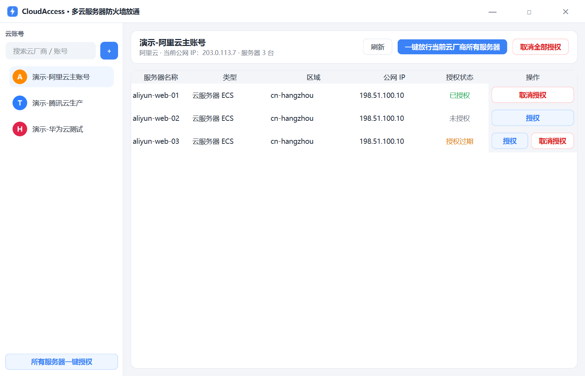
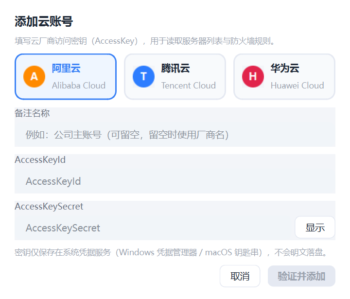

# ⚡ CloudAccess

[](https://github.com/drank5090/CloudAccess/releases)
[](https://github.com/drank5090/CloudAccess/actions)

**简体中文** | [English](README.en.md)

> 多云服务器防火墙一键放通工具：绑定阿里云 / 腾讯云 / 华为云账号，列出全部服务器，一键为当前 IP 放通所有端口，随时一键撤销。



## ✨ 特性

- **多云账号绑定** — 支持阿里云、腾讯云、华为云；同一厂商可绑定多个账号
- **在线验证** — 添加账号时实时校验 AKSK 有效性
- **全区域枚举** — 自动发现账号在所有区域的服务器，覆盖云服务器（ECS/CVM）与轻量应用服务器（SWAS / Lighthouse）
- **一键授权 / 一键撤销** — 针对当前公网 IP 放通/撤销所有端口：
  - 单台服务器：行内「授权」/「取消授权」
  - 单云厂商：面板顶部「一键放行当前云厂商所有服务器」
  - 跨账号：「所有服务器一键授权」（侧栏底部）
- **授权状态识别** — 已授权 / 未授权 / 授权过期（检测到本系统创建、但属于其他 IP 的规则）
- **安全存储** — AK/SK 仅存于系统凭据服务（Windows 凭据管理器 / macOS 钥匙串 / Linux Secret Service），绝不落盘为明文
- **无边框浅色界面** — PySide6 打造的现代桌面体验

## 🖥 界面

| 主界面 | 添加账号 |
| --- | --- |
|  |  |

## 🧩 支持范围

| 云厂商 | 云服务器 | 轻量应用服务器 | 防火墙载体 |
| --- | --- | --- | --- |
| 阿里云 | ECS | 轻量应用服务器（SWAS） | 安全组 / 轻量服务器防火墙 |
| 腾讯云 | CVM | Lighthouse | 安全组 / 实例防火墙 |
| 华为云 | ECS（含 HECS/L 实例） | — | 安全组 |

## 🚀 快速开始

### 方式一：下载安装包（推荐）

前往 [Releases](https://github.com/drank5090/CloudAccess/releases) 下载对应平台的压缩包，
解压后直接运行 `cloudaccess`（Windows）或 `./cloudaccess`（Linux）。

### 方式二：从源码运行

需要 Python ≥3.11 与 [uv](https://docs.astral.sh/uv/)：

```bash
git clone https://github.com/drank5090/CloudAccess.git
cd CloudAccess
uv sync
uv run cloudaccess        # 或：uv run python -m cloudaccess
```

### 添加账号

1. 点击侧栏右上角「**+**」打开添加账号对话框
2. 选择云厂商 → 填写备注名（可选）→ 粘贴 AccessKeyId / AccessKeySecret
3. 先「测试连接」在线校验，再保存（密钥写入系统凭据服务）

> 💡 **最小权限建议**：为 AKSK 绑定仅含服务器查看与安全组/防火墙管理权限的 RAM 子账号：
> - 阿里云：`AliyunECSFullAccess` + `AliyunSWASFullAccess`
> - 腾讯云：`QcloudCVMReadOnlyAccess` + `QcloudVPCFullAccess` + `QcloudLighthouseFullAccess`
> - 华为云：`ECS FullAccess` + `VPC FullAccess`

## ⚙️ 工作原理

```mermaid
flowchart LR
    A[绑定账号 AKSK] --> B[枚举全部区域服务器]
    B --> C[读取防火墙规则]
    C --> D{检测 CA 标记规则}
    D -- 命中当前 IP --> E[已授权]
    D -- 无标记规则 --> F[未授权]
    D -- 命中其他 IP --> G[授权过期]
    E --> H[行内取消授权]
    F & G --> I["一键授权（CA&#124;sid&#124;IP 规则）"]
```



- **规则标记**：本系统创建的每条放行规则都带 `CA|<账号短ID>|<IP>` 描述标记，
  与手工创建的规则完全隔离；「授权过期」即检测到本系统标记、但 IP 已变化。
- **幂等授权**：授权前自动清理本账号的旧规则（含过期 IP），不会产生重复规则。
- **状态刷新**：授权/撤销后自动重查规则并更新状态芯片。

## 📦 从源码打包

```bash
uv sync
uv run pyinstaller packaging.spec
# 产物位于 dist/
```

## 🛠 开发

```bash
uv sync                                   # 安装依赖
uv run pytest                             # 单元测试（离线、离屏）
uv run ruff check src/ tests/             # 代码检查
uv run python scripts/make_screenshots.py # 重新生成 README 截图
uv run python -m cloudaccess --demo       # 演示模式启动（离线）
```

## 📁 项目结构

```
src/cloudaccess/
├── models.py       # 领域模型与授权标记
├── storage.py      # 账号绑定存储（凭据入 keyring）
├── iputil.py       # 公网 IP 检测（HTTPS 白名单 + DNS 私网阻断）
├── service.py      # 状态判定与授权编排
├── providers/      # 阿里云 / 腾讯云 / 华为云适配器
└── ui/             # PySide6 界面（无边框、浅色主题）
```

## 🔒 安全说明

- 凭据仅存于操作系统凭据服务，元数据文件不含任何密钥
- 公网 IP 探测仅访问源码白名单内的 HTTPS 端点，并阻断解析到私网的地址
- 所有厂商 API 调用仅使用你绑定的凭据，不经过任何第三方服务器
- 请妥善保管 AKSK：泄漏后请立即在云厂商控制台禁用并轮换

## 📄 许可证

[MIT](LICENSE)
